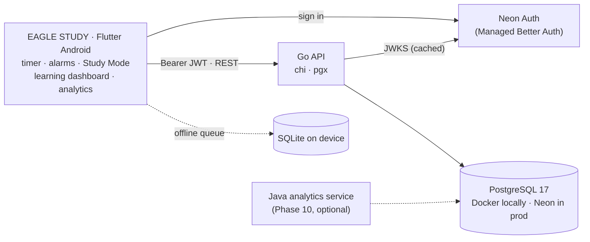

# Architecture

Status: Phase 1 (foundation). Last updated 26 Nov 2026.

## System overview

## Decisions

| # | Decision | Why | Consequence |
|---|----------|-----|-------------|
| D1 | **PostgreSQL is the system of record**, replacing Cloud Firestore. | User requirement. Relational integrity, SQL analytics, and timezone-correct aggregation in the database. | A backend API is required: clients never connect to the database directly. Firestore security rules become API authorization plus constraints. |
| D2 | **Neon Auth** for identity. | User choice. Managed Better Auth, no password storage in our code, and it pairs with Neon Postgres. | API verifies EdDSA JWTs via JWKS (`iss = aud =` auth origin, 15-min expiry). `users.id` is the token `sub`. |
| D3 | **Go API** owns all data access. | Small, fast, easy to deploy. Matches the Month 4–5 curriculum. | Spring Boot is kept for an optional analytics/reporting service later, so the Java skills still show up in the portfolio. |
| D4 | **Docker Postgres now, Neon later.** | Fast local loop and hermetic tests, with no cloud dependency until deployment. | Migrations are plain SQL (golang-migrate) and portable to Neon/RDS. |
| D5 | **Offline-first sync with client UUIDs + change feed.** | The Android app must work without a network. | `PUT` by client UUID is idempotent. Conflicts are last-writer-wins on `clientUpdatedAt`, and the loser gets `409` + the server copy. Deletes are tombstones. Pull uses a per-user `change_seq` cursor. |
| D6 | **Dev auth issuer** (`cmd/devauth`) mimics Neon Auth locally. | Lets the whole stack run without cloud credentials while exercising the real verification code. | Binds to loopback only and refuses anything else. Never deployed. |
| D7 | **Timestamps are the truth for timers.** | The spec requires accuracy across backgrounding and process death. | Elapsed = accumulated + (now − segmentStart), computed from persisted wall-clock anchors, never from tick counts. Already implemented in `StudyTimerState.secondsAt`. |
| D8 | **3D is optional and progressive.** | Must not block dashboard use or low-end devices. | Eagle: SceneView/Filament PlatformView with a Rive fallback. 3D roadmap: Flutter-rendered sphere (extends the existing `roadmap_screen.dart` projection) with an accessible 2D list fallback. |
| D9 | **Single Flutter Android app; no separate web dashboard.** | Decided 26 Nov 2026. One codebase, design system and language for all UI. The existing Flutter app already holds the roadmap and schedule. | The Next.js/React Three Fiber/Recharts parts of the original spec are dropped. Charts use `fl_chart`. The API has no browser clients, so CORS is off unless `CORS_ALLOWED_ORIGINS` is set. |

## Data integrity rules (enforced in PostgreSQL, not only in code)

- `duration_seconds ≤ ended_at − started_at`: focused time can never exceed wall time.
- `ended_at ≥ started_at`; durations 1 s–24 h; text length caps; laps ≤ 500.
- Every insert, update and delete of a study session is written by trigger to the append-only `study_session_audit` table.
- **Gap-free sync cursor.** Every write to a synced table runs in a transaction that first takes `SELECT … FROM users WHERE id = $1 FOR UPDATE`. So for any one user, `change_seq` is assigned and committed in the same order, and a reader using `since=` can't skip a row committed late. Tested under concurrency in `TestConcurrentWritesKeepChangeFeedConsistent`.

## Authorization model

- Every store method takes the caller's `userID` from the verified token and scopes the SQL by it. No handler accepts a user ID from the request.
- Reading or deleting another user's record returns `404`. Writing to another user's UUID returns `409` with no body data, so it leaks nothing.
- Token checks: signature via JWKS (rotating keys supported), `EdDSA` only (rejects `HS256`/`none` confusion), issuer, audience, expiry required, ±30 s leeway, `banned` claim → `403`.
- **Planned (Phase 10):** PostgreSQL row-level security as defence in depth, per-user rate limiting, and request audit logging.

## Time zones

- The database runs in UTC and every timestamp is `timestamptz`.
- Day, week (ISO, Monday) and month boundaries are computed in SQL with `AT TIME ZONE <user IANA zone>` (default `Asia/Kolkata`). That stays correct for DST zones if the user moves (e.g. Europe/Berlin).
- A session counts toward the local day on which it **started**.

## Known constraints and honest limitations

- **Neon Auth on Flutter:** there's no official Flutter SDK. Phase 9 will call the Better Auth HTTP endpoints directly (`/sign-in/email`, `/get-session` → `set-auth-jwt` header) and keep the session in Android Keystore-backed storage. That needs checking against a real Neon Auth instance before it's marked done.
- **3D eagle asset:** a realistic rigged, animated eagle has to be modelled in Blender or licensed. Code can't produce it. Until an asset exists, the app will say plainly that it shows a placeholder, not a realistic model.
- **Alarm audio** (ghost voice, horror laugh and so on) must be original recordings or properly licensed. None are bundled yet.
- **Alarm delivery** depends on Android version and manufacturer battery policies. Exact alarms are best effort on some OEMs, and the app will say so rather than promise delivery.
- **The 50 h/week schedule** (study until 02:00, resume 07:00) allows at most 5 h of sleep on weekdays. The app warns about this and offers a healthier alternative (see the roadmap docs). It does not present the schedule as sustainable.
